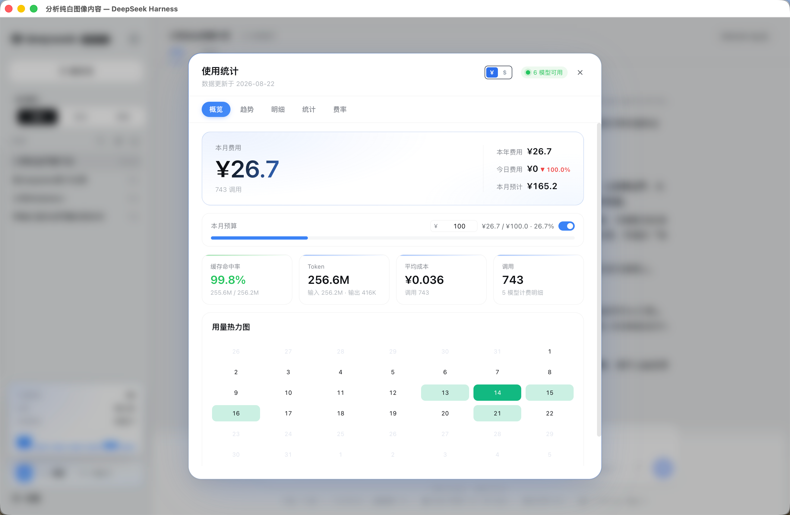
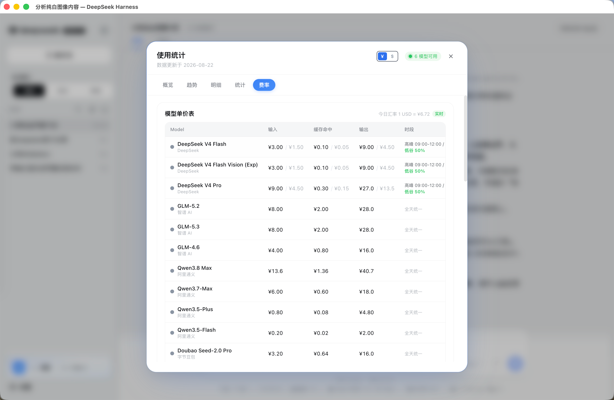
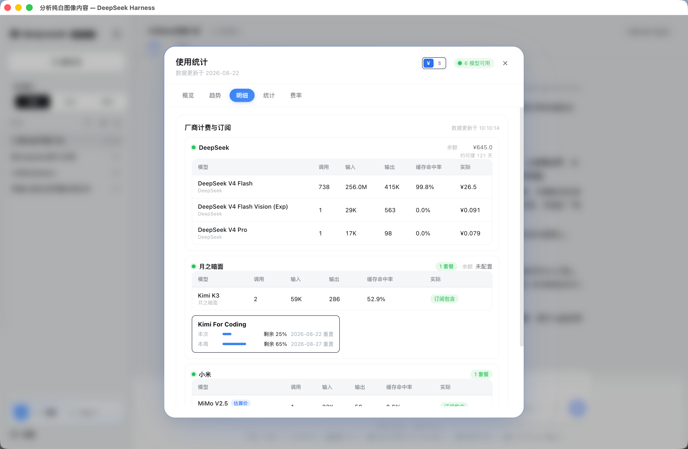
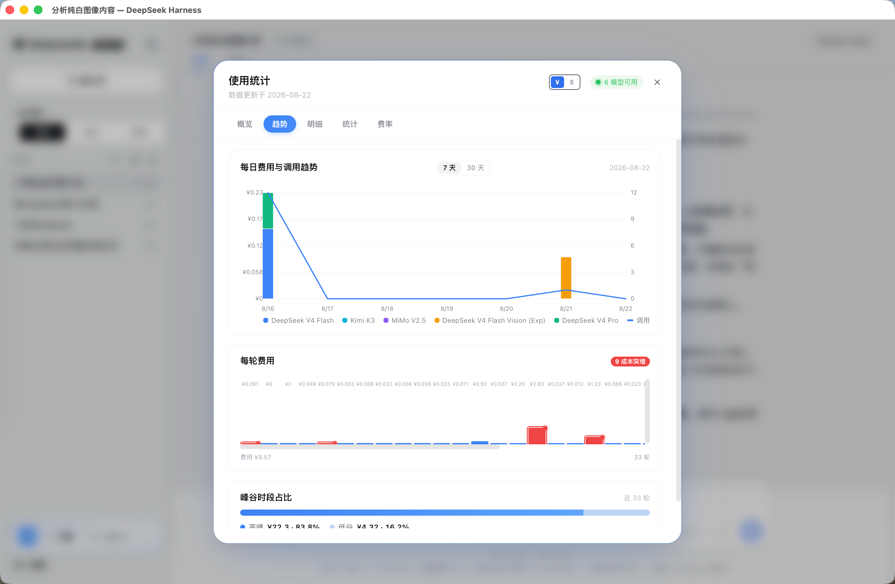
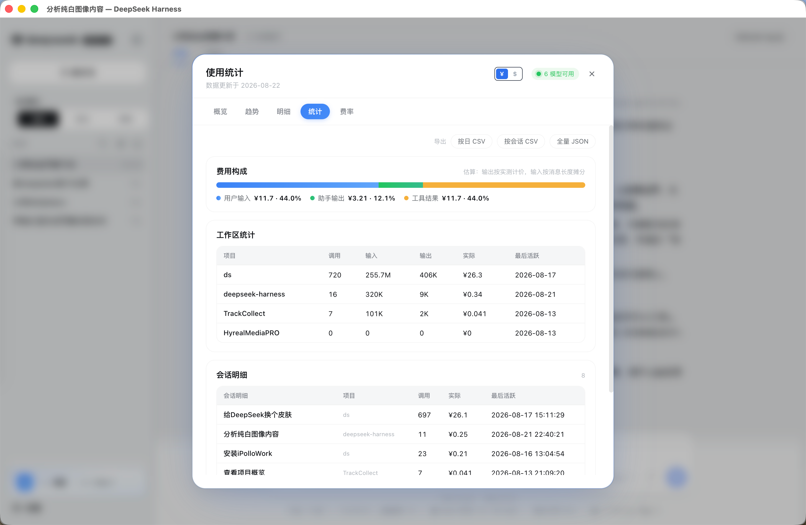

<div align="center">

# dsh-ui-usage-billing

<p align="center">See every cent of your model spend — at a glance.</p>

<p align="center">
  <a href="https://github.com/kenz1117/dsh-ui-usage-billing/stargazers"></a>
  <a href="https://www.npmjs.com/package/@kenz1117/dsh-ui-usage-billing"></a>
  <a href="https://www.npmjs.com/package/@kenz1117/dsh-ui-usage-billing"></a>
  <a href="https://github.com/kenz1117/dsh-ui-usage-billing/actions/workflows/ci.yml"></a>
  <a href="https://github.com/kenz1117/dsh-ui-usage-billing/blob/main/COMPATIBILITY.md"></a>
  <a href="https://github.com/kenz1117/dsh-ui-usage-billing/blob/main/LICENSE"></a>
  <a href="https://github.com/kenz1117/dsh-ui-usage-billing/pulls"></a>
  <a href="https://github.com/kenz1117/dsh-ui-usage-billing"></a>
  <a href="https://github.com/kenz1117/dsh-ui-usage-billing/graphs/contributors"></a>
  <a href="https://awesome-dsh-plugin.com"></a>
  <a href="https://dshfind.com/en/plugins/kenz1117/dsh-ui-usage-billing"></a>
</p>

[English](README.en.md) · [中文](README.md)

</div>

---

<div align="center">
  
</div>

### Demo GIF


## ✨ Why this plugin

Most billing plugins stop at "token count × unit price". dsh-ui-usage-billing turns billing into a **reconcilable ledger pipeline** — real usage, live prices, and peak/off-peak awareness that follows the model.

### Real usage you can reconcile
Usage is aggregated live from persisted session logs — never fabricated (an empty snapshot shows until real data arrives); daily official-balance deltas are cross-checked against the local ledger, and deviations beyond the threshold prompt a review — a bill that survives scrutiny.

### Live prices, history never rewritten
A live models.dev catalog + a built-in catalog of 239 models across 25 vendors + user-defined prices in the settings panel (bindable per relay origin) mean new models never wait for a release; DeepSeek time-of-day prices are **segmented by official change boundaries** (base price before 08-17, weekend peak hours 08-17~08-23, weekend all-day off-peak from 08-23) and later price changes never rewrite old bills.

### Peak/off-peak aware, alerts follow the model
The billing channel is detected from the current session's model: DeepSeek metered uses time-of-day prices (weekday 9-12 / 14-18 peak ×2, weekend all-day off-peak), Zhipu Coding Plan uses credit windows (weekday 14-18 peak at full rate, off-peak at **50% of base credits**) — the channel layer is extensible for more providers; a popover / system notification fires automatically before each switch, and only sessions whose current model actually involves peak/off-peak get alerted or show the tier section — no watching the clock.

### Subscriptions, balances and quotas on one screen
7 official provider balances (DeepSeek / Kimi / Zhipu GLM / Tencent Cloud TokenHub / …), Coding Plan quotas, relay-station rolling quota windows, self-declared endpoints, plus balance-delta reconciliation — what the plan deducted and what the balance deducted, verifiable side by side.

### Details few peers offer

- Not just "how much" but "on what": input split by cache hit/miss (including reasoning), official vs third-party buckets, drill-down by workspace/session/relay site, per-turn cost-spike attribution.
- A performance panel: per-model TTFT mean/P50/P90 and generation speed.
- Uncatalogued models are explicitly marked and never silently billed 0; one alias entry prices an out-of-catalog model.
- An optional `usage_stats` tool lets the model answer "what did I spend today" or "which site used the most".
- Zero tools registered by default: the single read-only `usage_stats` tool is registered **only** after the user explicitly turns on "inject usage query" in the settings (off by default). No system-prompt injection and no model-visible log events in any case.
- Chinese / English and ¥ / ≈$ toggles; no chart library, no external CDN, offline & self-contained.
- **Jump from a session row**: click a session title in the dashboard to open that conversation in the host (both generations of the host's session-selection channel are probed; hosts without one show a readable notice instead of silently doing nothing).
- **Context occupancy**: the overview shows the current session's context occupancy, window capacity, and composition (system / tools / messages), read from the host's official context projections. Sessions without a projection hide the whole card — it never shows a fabricated 0.
- **In-conversation entry**: the `/usage` command opens the billing dashboard directly (hosts without that capability degrade silently and leave the dashboard untouched).

## 📊 Dashboard

- **Sidebar trigger card**: persistent above the Settings button — a single headline figure (today / this week / this month, selectable in settings, optional day-over-day badge) with a 7-day sparkline mini-trend and a today-vs-average gauge needle; collapses to an icon button; hover reveals a quick-look card (updated-at + metric grid + top spenders / quota alerts).
- **Eight-tab dashboard**: Overview / Billing / Usage / Trends / Context / Agents / Rates / Settings — hero figures + comparisons + month projection + KPIs (hover for the metric definition) + usage heatmap, trends switchable between cost and tokens over 7/30 days, model price table, budgets (global + per model) and peak/off-peak alerts all live here; the settings page supports full-text search (zh/en keywords, empty state when nothing matches); tabs carry names only — no status badges.
- **Context section**: an occupancy bar plus next-request / last-request occupancy, window capacity and the composition split (system / tools / messages). The figures come from the host's official context projections; a session without one hides the whole section rather than showing a fabricated 0.
- **Agents section**: the agent network rebuilt from delegation relations — a parent conversation → sub-agent tree where each row carries its call count, own cost and **chain total** (itself + all descendants), which directly answers "which delegation was the most expensive".

  
- **Live cost bar**: persistent "this turn / session" cost with three positions (composer toolbar row / above / below, toolbar by default); the peak/off-peak tier & countdown section appears only when the current model involves peak/off-peak pricing; subscription low-quota chips appear at ≤20% remaining, red at ≤10%; hideable via the settings-tab toggle (display-only preference persisted locally; stats and alerts unaffected).
- **Peak/off-peak switch alert**: a popover plus an optional system notification before a switch; lead time / position / mode / preview configurable; copy differs by billing channel (DeepSeek price halves, Zhipu credits at 50%).
- **Session completion notification**: an optional system notification when a session transitions running → completed (off by default, enable it in the panel); multi-window / multi-instance dedup through the claim endpoint, so each session notifies once.
- **Plugin info card**: a persistent "About" card in the Settings tab — version read server-side from the package's `package.json` (single source of truth, correct on publish), author / repo / npm / license one click away.

## 💰 Billing engine

- **Provider-first grouping**: usage is grouped by the llm entry the calls actually went through (channel) — Tencent Cloud TokenHub / Token Plan / DeepSeek official / direct:<route> / unknown routes; the model brand stays as a row logo + sub-line. Official judgement follows the channel origin (`api.deepseek.com`) instead of the route name, so gateway routes named `deepseek-*` no longer count as official. `routeAliases` relocates renamed/deleted historical routes; `modelKeyAliases` binds uncatalogued model ids to catalog keys (date suffixes, org prefixes and the TokenHub short id `hy3` are recognized out of the box).
- **Live rate table**: models.dev fetched pricing + live-model alignment — all configured models included; peak/off-peak split (weekdays 9-12 / 14-18 peak ×2, weekends off-peak all day; history priced per official change boundaries, see "Billing details") + a live USD→CNY rate, auto-refreshed every 6 hours; the rate strip shows the last sync time with a **one-click "Sync now"** button (no host restart needed).

  
- **Custom unit prices**: set real paid prices (miss / cache-hit / output, optional USD and off-peak columns) for uncatalogued or repriced models; bindable per relay origin; an out-of-catalog model is priced as soon as you fill it in.
- **Official vs third-party buckets**: the detail cost column splits official direct / third-party relay ("official x / third y" when mixed); the Stats tab has a summary card; web-search assist calls count as official.
- **Monthly budget + tier alerts**: budget bar ≥80% amber, over-budget red pulse; one alert per 50/80/100% crossing; a balance below the CNY threshold alerts once a day. **Per-model budgets**: set a CNY cap per top-spending model of the month (independent of the global budget), with one alert per model per 80% / 100% crossing.
- **Cost-spike attribution**: last-40-turn cost bars, amount at bar top, peak/off-peak background bands, >2× spikes flagged with attribution.

## 🔌 Subscriptions & balance

- **Subscription quota**: auto-detects subscription providers (Kimi / Z.ai / OpenCode Go / MiniMax / OpenRouter / Xiaomi / Volcano…); those with a quota API show remaining % and reset time live, exhausted in red, otherwise "not wired"; subscription-channel model cost is 0, and plan tiers are recognized by the built-in knowledge base (e.g. OpenCode Go $10/mo + $30 weekly). **MiniMax note**: use `minimax-token-plan-cn` for the CN domain (`api.minimaxi.com`), `minimax` / `minimax-token-plan` international; override `baseUrl` per provider if needed. **Claude subscription**: auto-discovered after signing in to Claude Code locally (reads the OAuth token from `~/.claude/.credentials.json`), showing 5-hour / weekly window usage; a metered `anthropic` route in llm-pi-ai is not misdetected and stays token-billed. **CommandCode**: set `apiKeyEnv` (a `user_`-prefixed key) on the `commandcode` route in llm-pi-ai to see the 5-hour / weekly windows and monthly Credits.
- **Multi-provider balance**: built-in official balances for DeepSeek / Kimi / StepFun / SiliconFlow / xAI / Zhipu GLM, with an "≈N days" estimate from the 7-day daily burn; **Tencent Cloud TokenHub Token Plan** goes through the cloud-API control plane (TC3-signed, `src/tc3.ts`) — set the credential to a `<SecretId>:<SecretKey>` key pair (not the inference key) and name the route `tencent-tokenhub` / `tokenhub` / `tencent` / `tencentcloud`; a percentage window is produced only when both remaining and total quotas parse (never guessed).
- **Custom provider balance**: configure any HTTP endpoint (`extract` supports constant / dot-path / arithmetic, header `{{ENV}}` via the credentials seam).
- **Declared endpoints + balance reconcile**: `declaredEndpoints` self-declares balance/quota interfaces for vendors absent from the built-in table — dot-paths only ("where the number is"), no expressions; safety bounds (single-slash absolute path, GET only, no cross-origin redirects, response-size/timeout caps, credentials from the matched provider only) are enforced by `src/declarative.ts`; a wrong path is marked `declared` with a reason. **Balance reconcile** (`reconcilePath`) cross-checks the official balance change against the local ledger, flagging drift above the threshold (0.3 CNY and >15%); top-ups / grants / currency changes reset the baseline instead of alerting, and a flat balance (subscription spend) stays silent.
- **Relay-site attribution & quota**: usage is grouped by `baseURL` origin — multiple keys on one relay merge into a row named by its domain; New API (`/api/status`) and Sub2API (`/v1/usage`) are auto-detected for balance and rolling quota windows, labeled "no quota" when unreadable, <20% remaining in red; recognition caches for 5 minutes (per-key fuse-breaking), and the `relay-quotas` endpoint attaches `diagnostics` for "why is my relay not showing"; project attribution prefers the workspace title.

  

> For the full adapter matrix per channel (detection / endpoints / credentials / troubleshooting), see [docs/adapters.md](docs/adapters.md).

## 📈 Usage visualizations

- **Session detail + heatmap**: sessions sorted by cost (title / project / calls / cost / last active); "view all N sessions" opens a full-screen viewer (substring search by title / project / id, capped at 100 rows); month / half-year / year calendar heatmap (5-color scale, hover detail; the year view is ~52 weeks, GitHub-style, and the **half-year view uses 26 weeks of large cells** — half a year of intensity in one screenshot-ready chart) with a **cost / tokens metric switch**; total, active-day and streak counts on top.
- **Performance metrics**: per-model TTFT mean / P50 / P90, generation speed (tokens/s), total-latency mean; per-hour × per-model comparison curves — metric tabs, clickable model chips (top-5 by samples lit by default), hover snapping to the nearest hour with a crosshair and per-model values, broken lines for missing-sample hours (never fabricated); view preferences persist locally.
- **Token insights**: the daily token chart switches between two views — "Structure" (cache-miss / cache-hit / output, including reasoning) and "By model" (the toggle hides itself when snapshots lack per-day-per-model detail); hover shows the day's exact breakdown (thousand-separated); clicking a legend swatch or a model-table row focuses that model (click again to release); structural KPIs (cache-hit rate / reasoning share / input-output ratio / peak day); per-day CSV and JSON export (JSON includes per-day-per-model detail).

  
- **Export + drill-down**: daily / per-session / per-site CSV and full JSON from the Stats tab; cost breakdown / workspaces / session detail drillable (click a project row to expand its sessions); no chart library, no external CDN, pure design tokens.

  

## 🛡️ Robustness & privacy

- **Real usage aggregation**: incremental server-side aggregation (only written sessions recompute), per-session corruption tolerance, snapshot fallback; the optional `usage_stats` tool queries today / month / current session / cumulative spend, plus `bySite` (relay-attributed) and `relay` (relay-only) summaries.
- **Model health + uncatalogued annotation**: provider connection dots use tri-state shape + color coding (online = filled ●, failing = double ring ◎, unknown = hollow ○, with status text — colorblind-safe); uncatalogued models are marked and priced at the fallback, with the provider inferred (e.g. `mi-mimo-2.5` → Xiaomi); estimated-price models are labeled "estimated".
- **Keyboard accessible**: every interactive element in the dashboard and the sidebar trigger card shares a unified focus-visible outline (appears only for keyboard Tab, never on mouse click).
- **Multi-language + three currencies**: language (EN / 中) and currency (¥ CNY / $ USD / € EUR) switch **independently**, both plugin-only — neither leaks into the host UI. The rate table, the sidebar card and the composer capsule all convert to the selected currency, and both choices persist locally. On first upgrade the language is seeded once from the stored currency (“$” → English), so no existing user’s interface language changes silently.
- **Security hardening**: every HTTP endpoint enforces loopback-only access via a dual check of the peer socket address and an exact Host-header match, rejecting `127.0.0.1.evil.com`-style DNS-rebinding names (reverse-proxy deployments can allow specific names with `trustedHosts`; the peer-socket check stays mandatory); write paths additionally validate a loopback Origin and Content-Type with a body-size cap against cross-site rewrites; balance / subscription / pricing fetches carry bounded retries with per-upstream circuit breaking (auth failures are config issues and do not trip the breaker).
- **Export injection guard**: CSV cells starting with `=` / `+` / `-` / `@` get a leading single quote and full escaping, so they cannot execute as formulas in Excel / WPS.
- **Privacy baseline**: zero tools registered by default — no system-prompt injection, no model-visible events written to the session log; it only aggregates from existing session logs, whose content is owned by other packages. The sole exception is the read-only `usage_stats` tool registered after the user opts in (see "Model Experience"); it reads only this plugin's own aggregates, never session bodies, and never writes back to the log.

## 🚀 Quick start

Check your host generation first (`dsh --version`), then pick the matching install command — **a mismatched line is rejected by the DSH Store via the `engines.dsh` declaration** (declared since v1.0.41). Note that `dsh plugin add` requires an explicit `--profile` (otherwise it fails with `required option '--profile <name>' not specified`), and prefer **pinning an exact version** over `@latest` (pnpm's `minimumReleaseAge` cooldown skips freshly published versions and may fall back to the other line):

- **DSH 0.1.2 ~ 0.2.0 era** (0.1.2-alpha.1 and later; npm `latest` currently at 0.2.0-rc.2; `npm ls -g @deepseek-ai/dsh` shows 0.1.2-* ~ 0.2.0-*):

  ```sh
  dsh plugin --profile web add npm:@kenz1117/dsh-ui-usage-billing@latest
  ```

- **DSH 0.1.0-rc.8 ~ 0.1.1-rc.2** (legacy hosts; **this line is frozen** — `stable` points permanently at the final v1.1.17, so existing installs keep working but receive no further releases; rationale and the formal EOL trigger are in [COMPATIBILITY.md](COMPATIBILITY.md)):

  ```sh
  dsh plugin --profile web add npm:@kenz1117/dsh-ui-usage-billing@stable
  ```

Alternatively, add it to the host `cordis.patch.yml` by hand:

```yaml
- insert:
    - id: ui-usage-billing
      name: '@kenz1117/dsh-ui-usage-billing'
```

After the host starts, the billing entry appears above the sidebar Settings. No extra configuration is needed; when `sessionPersistence` is available it aggregates real usage automatically.

### 🛒 Install from the DSH Community Market

This plugin also publishes a catalog entry using the Market's **Path A standard source**. Paste the manifest URL below into *Settings → Plugins → Plugin Store → Source management → Add source*, then browse and install with one click:

```
https://kenz1117.github.io/dsh-ui-usage-billing/catalog-source.json
```

Market-hosted installs resolve an exact stable version from the npm registry (the Host resolves the install target from npm `latest`; the version listed in the catalog is display-only). The catalog files live in `catalog/` in this repository and are validated in CI before being published by GitHub Pages.

## ⚙️ How it works

The plugin has a server side and a browser side:

```
Browser                                   Server (Node)
  │                                        │
  ├─ GET /api/billing/usage-stats ────────▶ ├─ sessionPersistence walks persisted session logs
  │                                        ├─ attributes a call to its preceding request/header model
  │                                        ├─ buckets tokens by cache hit / miss
  │                                        └─ estimates cost (CNY) from the live rate table
  ├─ GET /api/billing/pricing ────────────▶ ├─ models.dev model prices + Tencent Finance FX (tiered fallback)
  ├─ GET /api/billing/balance ────────────▶ ├─ DeepSeek official balance API (credentials seam)
  ├─ llm.models health probe ─────────────▶ └─ returns aggregated stats JSON
  └─ renders the dashboard
```

- **Server** (`src/index.ts`): injects `webServer`, `sessionPersistence` and `credentials`, and registers `GET /api/billing/usage-stats`, `/api/billing/pricing`, `/api/billing/balance`, `/api/billing/subscriptions`, `/api/billing/relay-quotas`, `/api/billing/notify-claim` (cross-instance claim for completion notifications) and `/api/billing/usage-tool` (read/write of the `usage_stats` tool switch). The aggregator caches folded results per session: each LLM call is attributed to the model of its preceding `request/header`, tokens split into cache-hit / cache-miss buckets, dates bucketed by the local timezone; a log file with unchanged mtime+size reuses its cached fold, only written sessions are re-folded, and the whole document has a 5s TTL to coalesce heavy polling. Every successfully folded session is also atomically written to an independent durable usage ledger, so permanently deleting a session no longer removes its historical cost or tokens. Aggregation logic lives in `src/aggregate.ts`.
- **Browser** (`src/client/`): requests the endpoints above to render the dashboard and probes each provider connection via `llm.models`. Until real data arrives it shows an all-zero empty snapshot, never fabricated samples.

## 💡 Billing details

The rate table (`src/client/pricing.ts`) stores each model in its **native currency**: domestic providers enter CNY directly, overseas providers enter USD. Cost is computed and displayed in CNY uniformly — USD models convert via the **live rate**, domestic models never pass through a rate. At startup the server fetches the live rate and model prices (`src/pricing-fetch.ts`): USD→CNY prefers the Tencent Finance quote (keyless, reachable in China), falling back to open.er-api then the built-in default; it then refreshes every 6 hours, and the rate-table modal shows a "today's rate" marker plus live / built-in badge. The **display currency follows the user**: switching ¥ / $ converts each per-1M-token unit price via `convertUnitPrice` at the live rate (falling back to the native currency when the rate is unavailable).

```
cost (CNY) = (missInput × p_input + cacheHit × p_cacheHit + output × p_output) / 10⁶
           —— prices in native currency; USD models convert at the live USD → CNY rate
```

`input` in the stats is total input (cacheHit + cacheMiss); estimation splits it into hit / miss to avoid double counting. Models with two-band billing are mixed by `DEFAULT_PEAK_SHARE` (default 0.5); weekends (Beijing Sat/Sun) are charged at the off-peak rate all day.

### Supported models (2026-10 lineup, OpenAI-compatible series, 239 models)

The full catalog lives in the Rates tab and in `BUILTIN_MODEL_CATALOG` of `src/builtin-catalog.ts` (238 active + 1 retired model kept for historical repricing); representative models per vendor below.

| Provider  | Representatives                                        |
| -------- | -------------------------------------------- |
| DeepSeek | V4.1 Flash, V4 Pro (3 models; priced per official change boundary: base tier → peak/off-peak v1 → weekend off-peak) |
| Zhipu AI  | GLM-5.3, GLM-5.2 (17 models)                     |
| Aliyun    | Qwen3.8 Max, Qwen3-Coder 480B (27 models)        |
| Doubao    | Doubao Seed-2.1 Pro, Doubao Seed-2.0 Pro (13 models) |
| Moonshot  | Kimi K3, Kimi K2.7 Code (16 models)              |
| Xiaomi    | MiMo V2.6 Pro (6 models)                         |
| MiniMax   | MiniMax-M3, MiniMax-M2.7 (8 models)              |
| Unisound  | U2 Flash, Unisound U2 (3 models)                 |
| Baidu     | ERNIE-5.1, ERNIE-4.5 300B (2 models)             |
| Tencent   | Hunyuan Hy3, Hunyuan T1 (3 models)                       |
| Anthropic | Claude Opus 5, Claude Sonnet 5 (14 models)    |
| Mistral AI | Mistral Large 3, Mistral Small 4 (30 models)     |
| Cohere    | Command A, Command R (7 models)                 |
| OpenAI    | GPT-6 Astra, GPT-5.6 Sol / Terra / Luna (38 models) |
| Google    | Gemini 3.1 Pro, Gemini 3.6 Flash (25 models)      |
| xAI       | Grok 4.7, Grok 4.20 (8 models)                     |
| Meta      | Llama 4 Maverick, Muse Spark 1.3 (8 models)                     |
| Meituan   | LongCat 2.0 (estimated)                             |
| ModelBest | MiniCPM-V 4.5 (estimated)                           |
| Xiaohongshu | Dots3-Note Preview (estimated)                      |
| 01.AI     | Yi-Lightning                                  |
| StepFun   | Step 3.7 Flash, Step 5 Preview (3 models)                                |
| iFlytek   | Spark 4.0 Ultra (plan-based)¹                       |
| SenseTime | SenseNova 6.5 (beta)¹                         |
| Baichuan  | Baichuan M3-Plus                              |
| Other     | Unified fallback pricing for uncatalogued models (cost 0)                      |

> ¹ iFlytek and SenseTime have not published per-token prices — the table shows estimates; cost is 0 when these models go through a subscription channel (coding / token plan / opencode), and recalibrates automatically when official pricing is published. Subscription channels align with pi-ai built-in providers (kimi-coding, zai-coding-cn, opencode, opencode-go, qwen/xiaomi token-plan regional variants), overridable via `subscriptionProviders`.

To add a model: append an entry to `BUILTIN_MODEL_CATALOG` in `src/builtin-catalog.ts` (key aliases live in `BUILTIN_MODEL_KEY_ALIASES` in the same file; the catalog is built only into the node half and served to the client from the host via `/api/billing/pricing`).

## 🔌 HTTP API

The public HTTP endpoints and field definitions are documented in source: `GET /api/billing/pricing`, `/api/billing/balance`, `/api/billing/usage-stats`, `/api/billing/subscriptions`, `/api/billing/relay-quotas`, `/api/billing/notify-claim` (cross-instance claim for completion notifications) and `/api/billing/usage-tool` (`usage_stats` tool switch, GET/POST) (see `src/index.ts`, `src/aggregate.ts`, `src/relay.ts`). The `usage-stats` payload carries `bySite` (relay-attributed usage distribution: `site:<origin>` / `direct:<provider>` / `unknown`) and `unpricedModels` (ids of models with no price); `relay-quotas` returns `quotas` plus `diagnostics` (per-route origin / kind classification, for "why is my relay not showing"). All endpoints accept loopback requests only (peer socket address + Host header verified).

## ⚙️ Configuration

| Field                    | Default                                  | Description                                                                                                           |
| ----------------------- | --------------------------------------- | -------------------------------------------------------------------------------------------------------------------- |
| `statsPath`             | unset                                   | Absolute path to a fallback `.dsh-usage-stats.json` (used when `sessionPersistence` is unavailable)                    |
| `ledgerPath`            | `<harness home>/.dsh-usage-ledger.json` | Independent durable ledger path; stores folded metrics only (no message bodies or session titles), so deletion does not erase recorded usage. The default root follows the host harness home (`DSH_HOME` env first, falling back to `~/.dsh`), so isolated environments never share ledger data (issue #52) |
| `balanceApiKeyEnv`      | `DEEPSEEK_API_KEY`                      | Credential ref for the DeepSeek balance query; only used as a fallback when llm-pi-ai has no `apiKeyEnv` for deepseek |
| `subscriptionProviders` | built-in channel list (incl. `tencent-token-plan`) | Subscription (coding / token plan) provider id list — tokens counted, cost 0; aligned with the subscription-card recognition      |
| `routeAliases`          | not set                                | Historical route aliases (old provider route name -> current route): renamed/deleted routes relocate into their channel instead of the "unknown" bucket. Example: `{ "deepseek-official": "tencent" }` |
| `modelKeyAliases`       | not set                                | User model aliases (log model id -> billing catalog key, value must be an existing `MODEL_CATALOG` key): bind uncatalogued ids without waiting for a release. Example: `{ "hy4-preview": "hunyuan" }` |
| `monthlyBudget`         | unset                                   | Default monthly budget (CNY); sent with usage-stats as the budget bar's initial amount (user UI settings take precedence and persist locally) |
| `lowBalanceThreshold`   | `50`                                    | Low-balance alert threshold (CNY); sent with usage-stats, alerts once a day when any provider's CNY balance is below it |
| `trustedHosts`          | unset                                   | Extra host names allowed through the Host-header check when DSH runs behind a reverse proxy (e.g. `['llm.example.com']`); **empty by default = behaviour identical to previous releases**. Consulted only after the peer-socket loopback check has passed, so it widens only the second, defence-in-depth layer; exact host match, case- and port-insensitive, with no suffix or wildcard semantics |
| `subscriptionPlans`     | auto-detect                             | Subscription quota adapter whitelist (`{ provider, baseUrl?, region? }`); when unset, auto-detects all subscription providers from `llm-pi-ai` (queries those with a quota API, marks the rest) |
| `declaredEndpoints`     | unset                                   | Declared endpoints (`{ displayName, origin, path, fields?, windows?, raw? }`): self-declare balance/quota interfaces for providers absent from the built-in table, writing only dot-paths ("where the number is") with no expressions; the request URL is built from the matched same-origin provider's `origin` and safety bounds (single-slash absolute path, GET only, reject cross-origin redirects, response-size/timeout caps, credentials only from the matched provider's own `apiKeyEnv`) are enforced by `src/declarative.ts` |
| `reconcilePath`         | `<harness home>/.dsh-usage-reconcile.json` | Balance-delta reconcile baseline path (default root also follows `DSH_HOME` / `~/.dsh`); cross-checks the official (DeepSeek-direct only) balance change against the local ledger's official-channel cost for the day, and flags a drift above the threshold (0.3 CNY and >15%); top-ups / grants / currency changes reset the baseline instead of alerting |
| `searchCallEstimateCny` | `0.02`                                  | Per-call cost estimate for web-search requests (`web/deepseek-search-llm-request`, which log no usage events) in CNY; set to 0 to disable the estimate (calls still counted, not billed) |

## 🛠 Development

Requirements: Node.js ^22.19 || >=24, pnpm.

```sh
pnpm install
pnpm test          # unit + API-contract mock + UI component tests (vitest + jsdom)
pnpm lint          # discipline guards: types / logging / empty catch / CSS↔TSX class parity
pnpm run build     # tsc -b && tsdown, produces lib/index.js and lib/client.js
```

For on-machine debugging: `dsh plugin --profile web add "link:<absolute path to this repo>"` points the host at this working tree — afterwards edit code → `pnpm run build` → restart the host, no npm publish needed (see [docs/DEV-MODE.md](docs/DEV-MODE.md) for the loading chain). HTTP-contract e2e: `pnpm test:e2e` (needs a local dev host running). Engineering conventions (two-line release strategy, host-upgrade SOP, acceptance checklists) live in [AGENTS.md](AGENTS.md).

## 📦 Release

This package is a standalone npm package. Releases go through the preview line (`latest` + `alpha` tags switched together); the stable line (`stable`) is frozen — see [COMPATIBILITY.md](COMPATIBILITY.md).

```sh
pnpm test && pnpm run build   # full tests + build before release
npm publish --access public
npm dist-tag add @kenz1117/dsh-ui-usage-billing@<version> alpha
```

The host discovers the browser side automatically via the `dsh.client` declaration (`platform: web`) and the `exports["./client"]` bundle in `package.json` — no registry registration needed. The compatibility matrix is declared per version from real-device testing (`dsh.compatibility.dshReleases`); run `node scripts/check-compat.mjs --peer package.json` before and after publishing to re-verify.

## 🔐 Permissions & Compatibility (DSH STORE)

- **Permission level: high**: reads durable session logs (files), calls official multi-vendor / subscription / balance / pricing APIs (network), reads `apiKeyEnv` via the credentials seam (credentials), writes the ledger and stats snapshot under the harness home (`DSH_HOME` / `~/.dsh`) (persistent state); **no** command execution / shell.
- **Update channel: `user-reviewed`**: with file / network / credential capabilities, DSH STORE requires local manual confirmation on every install; review the repo, pinned commit, lifecycle scripts, and impact scope before installing.
- **Compatibility**: the preview line (npm `latest`/`alpha`, 1.6.x — kept above the stable line to kill the version inversion) targets DSH `0.1.2-alpha.1` ~ `0.2.1-rc.2` (host `latest` currently at 0.2.0-rc.2, preview at 0.2.1-rc.2; the full 0.2.1 series is declared per version); the stable line (npm `stable`, 1.1.x, **frozen**, final v1.1.17) targets legacy hosts `0.1.0-rc.8` ~ `0.1.1-rc.2`. Per-version declarations live in `package.json` under `dsh.compatibility`; the two-line mapping and monitoring mechanism are documented in [COMPATIBILITY.md](COMPATIBILITY.md). Node.js `^22.19.0 || >=24.0.0`.
- **Lifecycle**: no `preinstall` / `install` / `postinstall` / `prepare` (ready on install).
- **No impersonation**: adds only its own entry id `ui-usage-billing`; `@deepseek-ai/dsh-*` packages are `peerDependencies` only (no reinstall / replace / shadowing of official components); the package uses the third-party namespace `@kenz1117/*`.
- **Build artifacts**: runtime files `lib/*` and `cordis.patch.yml` are committed at the pinned commit and declared in `files`.
- **Source anchor**: sources are locked to a pinned commit on the GitHub default branch and traceable. DSH STORE automation re-reads the default-branch HEAD roughly every 8 hours as the new pinned commit and decides re-review by SemVer change.

## 🤖 Model Experience

**None by default.** The plugin exposes no tool to the model out of the box: the "inject usage query" setting is off by default, and while it is off the model can neither see a tool nor read any data from this plugin.

After the user explicitly enables that setting, exactly **one** read-only tool is registered:

| Tool | Parameters | Behaviour |
| --- | --- | --- |
| `usage_stats` | `range`: `today` / `month` / `session` / `all` / `bySite` / `relay` | Queries the usage and estimated cost this plugin already aggregated (CNY, estimated from the official price catalog — not a bill); `session` requires an agent session context |

Boundaries: the tool reads only this plugin's own aggregates — never session bodies, never prompts, and it never writes back to the session log. The plugin injects no system prompt, writes no model-visible events to the session log, and touches no session KV cache in any case. Usage statistics are aggregated by the server from existing session logs, whose content is owned by other packages. The tool consumes context on every request, which is why it stays off by default.

## ⚠️ Known Limitations and Deferred Work

- **Balance queries cover DeepSeek / Moonshot (Kimi) / StepFun / SiliconFlow / xAI / Zhipu GLM (Z.ai CN region) / Tencent Cloud TokenHub (token-plan quota)**: the first six use a standard Bearer API key; Tencent Cloud uses the cloud-API key pair (`<SecretId>:<SecretKey>`, TC3-signed management API). Other providers expose no public balance API or need non-Bearer auth (Xiaomi MiMo via console Cookie, SenseTime via AccessKey signing, MiniMax/Doubao via quota or AK/SK), so they currently show "not configured"; the extension point is `src/balance.ts` (add a querier per provider balance API).
- **Relay quota depends on upstream private schemas**: New API / Sub2API interface fields are not public, so an unreadable station is labeled "no quota" rather than fabricating an amount; if a station's response fields differ, extend the parsers in `src/relay.ts`. An "unknown route" means that route exists neither in the current provider config nor in the host llm registry (deleted config, logs older than the install, …); historical call data is not lost — re-adding the same-named route restores attribution automatically. Cost in the unknown-route bucket is always 0 (issue #82): the spending party cannot be verified — same posture as uncatalogued models and subscription channels — while tokens are still counted, and the panel shows "—" for the group cost with an explanatory note. Channels registered by another plugin through `ctx.llm.registerAdapter` (e.g. CommandCode) are **not** unknown routes: the plugin discovers them from the host llm registry and bills them in the `direct:<provider>` bucket at the model's official catalog price (issue #91); the registry is read through `ctx.get('llm')` (no `inject` requirement), and an unreadable or empty registry warns once (panel numbers and the unknown policy are unchanged) so this class of failure is never silent again.
- **Overspend notifications rely on the browser Notification API**: when permission is denied or the platform lacks support, only the in-UI red-pulse fallback remains — no host-level notification channel; notifications are capped at once per day.
- **Session rows are not navigable**: clicking a session row does not open that session (cross-plugin navigation needs a host session-selection channel); the panel shows the top 20 by default and the "view all" full-screen viewer is capped at 100 rows.
- **Cost is a catalog estimate**: models without published per-token pricing (iFlytek, SenseTime, Xiaomi) use estimates (feature-list footnote ¹); official billing is authoritative.
- **The ledger starts at its first successful aggregation**: sessions permanently deleted before the upgrade and absent from the old snapshot cannot be recovered. Manually deleting `.dsh-usage-ledger.json` and its `.bak` clears independently retained history. Only calls successfully observed by this plugin are retained.

## ❤️ Contributors

- [@lucagiftzek](https://github.com/lucagiftzek) — rate-table CSS polish (PR #59), `trustedHosts` reverse-proxy support (PR #60), currency preference persistence (PR #58), rate-table search (PR #67), peak/off-peak indicator dots with pin-to-composer (PR #68), the EUR display currency with language decoupling (PR #70), the first pricing fetch moved ahead of the warmup replay (PR #55), evidence-based models.dev listings (PR #56), and hardcoded UI strings routed through locale dictionaries (PR #61)
- [@hwangjunjie](https://github.com/hwangjunjie) — Tencent Cloud TokenHub / Token Plan subscription quota adaptation (`src/tc3.ts`), provider-first channel grouping with gateway badges, the `routeAliases` / `modelKeyAliases` config (PR #35), and subscription badges decided per channel on the day × model × site cells (PR #83)
- [@ciphoo](https://github.com/ciphoo) — MiniMax CN Token Plan quota support (PR #5), `minimax-cn` subscription key wiring (PR #12), a concurrent-ledger-write `MoveFileExW EPERM` fix on Windows (PR #11)
- [@fabulousyuann-tech](https://github.com/fabulousyuann-tech) — durable ledger that retains usage after session deletion (PR #8)
- [@hi-fangj](https://github.com/hi-fangj) — hover tooltip with the exact per-day token breakdown on the token daily chart (PR #21), the live-cost capsule toggle (PR #22), the per-model view and legend focus for the token daily chart (PR #23), and the per-model comparison curve in the perf panel (PR #24)
- [@aizhimoran](https://github.com/aizhimoran) — peak/off-peak tiering for Chinese statutory holidays and shifted workdays: DeepSeek usage-based pricing bills holidays entirely at the off-peak rate (official 2026-09-19), with a 10-day countdown scan window (issue #73, PR #74)
- [@kidbird](https://github.com/kidbird) — wired up the international Z.ai Coding Plan (`zai-coding`) subscription quota, pinning each route to its own region with split key fields (PR #79)
- [@yuxu4468-hash](https://github.com/yuxu4468-hash) — cataloging for bare relay-exposed model ids: Grok 4.5/4.6, GPT-5.5, GPT-6.1 Sol, Claude Opus 4.7/4.8 and Fable 5 (PR #87), plus the GPT image models `gpt-image-2` / `gpt-image-2.5-sunburst` (PR #88)
- [@JinruiWang](https://github.com/JinruiWang) — workbuddy adapter channel pricing and the fold-before-live-catalog dual-caliber fix: the known-channel list, three lazy-reprice gates (ledger, cache hit, incremental cursor) and the stable-stamp reproduction test (issue #90)
- [@gitfangj](https://github.com/gitfangj) — `sync.sh` brace-variable compatibility under the macOS default bash 3.2

## 📄 License

[MIT](LICENSE) © 2026 KenZ (kenz1117)
