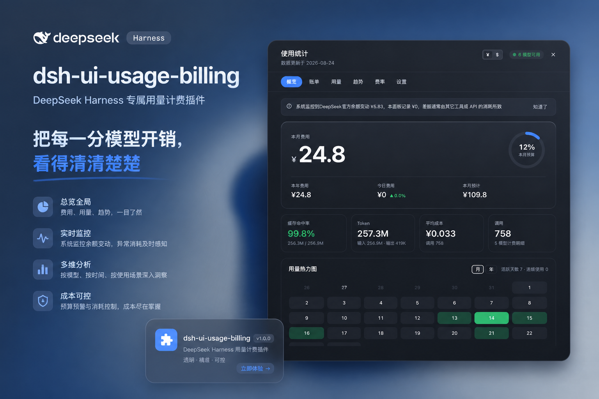
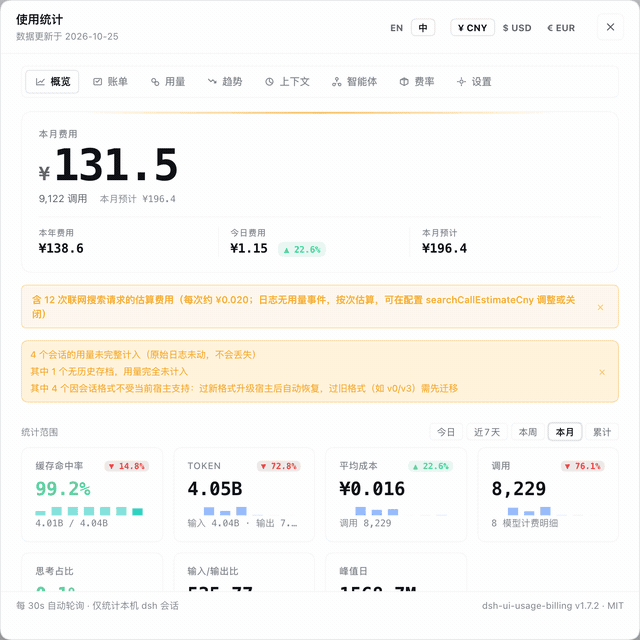
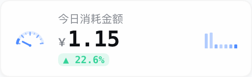
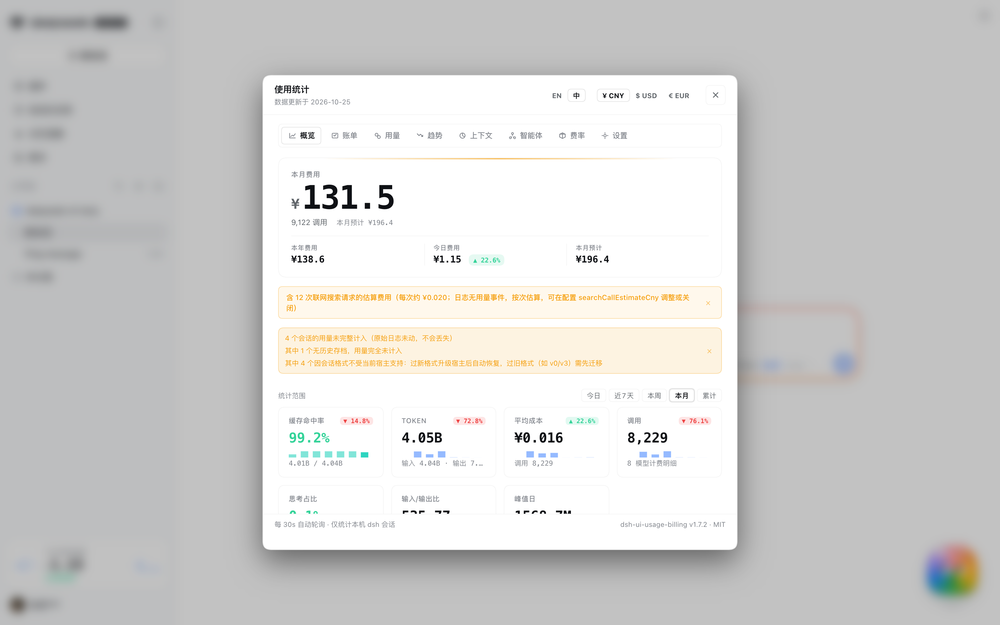
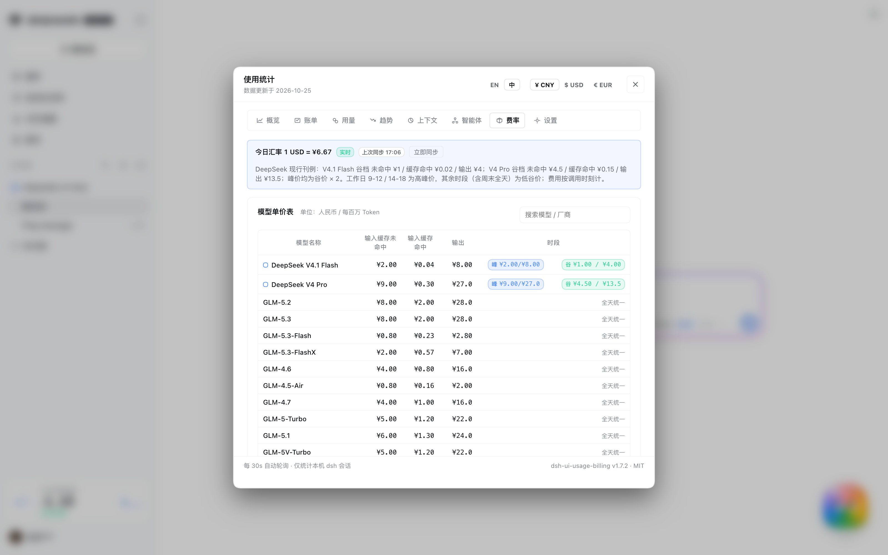
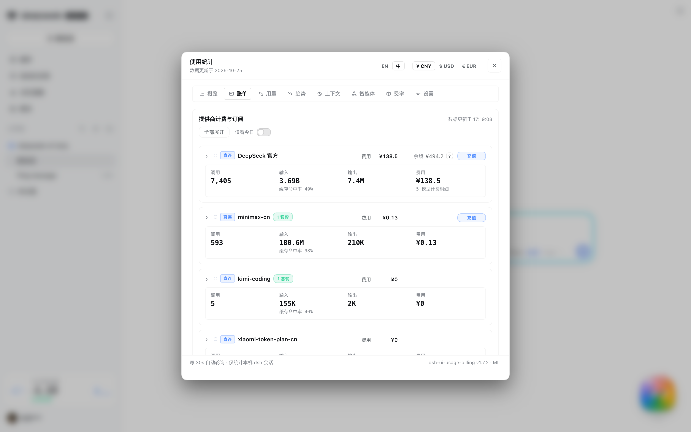
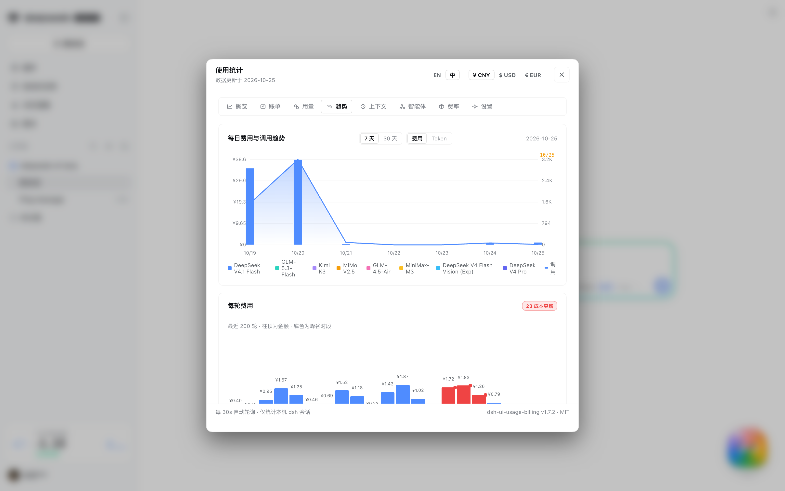

<div align="center">
  

  <p><strong>真实用量 · 历史账本 · 峰谷计价 · 订阅额度</strong></p>

  <p>
    <a href="https://github.com/kenz1117/dsh-ui-usage-billing/actions/workflows/ci.yml"></a>
    <a href="https://www.npmjs.com/package/@kenz1117/dsh-ui-usage-billing"></a>
    <a href="https://www.npmjs.com/package/@kenz1117/dsh-ui-usage-billing"></a>
    <a href="https://github.com/kenz1117/dsh-ui-usage-billing/blob/main/COMPATIBILITY.md"></a>
    <a href="https://github.com/kenz1117/dsh-ui-usage-billing/blob/main/LICENSE"></a>
  </p>

  [中文](README.md) · [English](README.en.md) · [快速开始](#-快速开始) · [兼容矩阵](COMPATIBILITY.md)
</div>

---

### 演示动图

新版仪表盘八个分区逐个切换（概览 / 队列 / 账单 / 用量 / 趋势 / 智能体 / 费率 / 设置）：



## ✨ 为什么选它

市面计费插件大多停在「token 数 × 单价」。dsh-ui-usage-billing 把计费做成一条**可对账的账本链路**——用量是真的、价格是活的、峰谷跟着模型走。

<table>
  <tr>
    <td width="50%" valign="top">
      <h3>账是真的，还能对账</h3>
      <p>用量从持久化会话日志实时聚合，绝不伪造样本（数据到达前显示空快照）；官方余额当日变动与本地账本交叉对账，偏差超阈值主动提示核对——账单经得起质疑。</p>
    </td>
    <td width="50%" valign="top">
      <h3>价格是活的，历史不重算</h3>
      <p>models.dev 实时目录 + 内置 25 厂商 241 款模型 + 设置面板自定义单价（可按中转站绑定同模型不同价），新模型无需等发版；DeepSeek 分时价按官方变更节点<strong>分段计价</strong>（8-17 前基础价、8-17~8-23 周末计峰、8-23 起周末全谷），价格调整永不回写旧账。</p>
    </td>
  </tr>
  <tr>
    <td width="50%" valign="top">
      <h3>峰谷全感知，提醒跟着模型走</h3>
      <p>计费通道按当前会话使用的模型自动识别：DeepSeek 按量走分时价（工作日 9-12 / 14-18 高峰 ×2、周末全天低谷），智谱 Coding Plan 走积分峰谷（工作日 14-18 高峰全额、非高峰<strong>积分 5 折</strong>），通道层可扩展、更多厂商逐步接入；切档前弹窗 / 系统通知自动提醒，且只有当前模型真正涉及峰谷才会提醒、费用条才显示档位——不用你盯时间表。</p>
    </td>
    <td width="50%" valign="top">
      <h3>订阅、余额、额度一屏闭环</h3>
      <p>DeepSeek / Kimi / 智谱 GLM / 腾讯云 TokenHub 等 7 家官方余额、Coding Plan 额度、中转站滚动额度窗口、自声明端点，再加余额差对账——订阅扣的和余额扣的同屏可查、交叉验证。</p>
    </td>
  </tr>
</table>

### 更多能力，一处收口

| 费用归因 | 自动化与入口 |
| --- | --- |
| 缓存命中、官方 / 三方、工作区 / 会话 / 中转站逐级下钻；子智能体按委派链合并，TTFT、生成速度与费用突增都有据可查。 | 低谷任务队列支持草稿与 JSON 批量入队；会话行可跳回宿主对话，`/usage` 直接打开仪表盘。 |
| **计价与模型** | **体验与隐私** |
| 未收录模型明确标注，可用别名和自定义单价补全；可选 `usage_stats` 只读工具默认关闭。 | 中文 / English、¥ / $ / € 独立切换；无图表库、无外部 CDN，默认不注入系统提示。 |

## 📊 仪表盘

### 侧栏与即时反馈

- **触发卡**：今日 / 本周 / 本月主数字、近 7 天趋势与当日水位；支持完整卡片、紧凑图标、完全隐藏，悬停可看速览。
- **费用条与提醒**：常驻本轮 / 会话费用，按当前模型显示峰谷和订阅额度预警；切档与会话完成可发系统通知。



### 八个分区，共享统一口径

概览 / 队列 / 账单 / 用量 / 趋势 / 智能体 / 费率 / 设置。Hero 与 KPI 支持今天、近 7 天、本周、本月、累计和自定义日期；趋势、热力图、预算、费率与全文搜索设置都使用同一份真实账本。



<details>
<summary><strong>队列、智能体与设置细节</strong></summary>

- **队列**：显示峰谷倒计时和待执行 / 执行中 / 需核对 / 已完成任务；JSON 单批最多 50 条，任一无效则整批不写入。文件锁与租约避免同一 `DSH_HOME` 多实例重复提交。
- **智能体**：按委派关系还原父对话 → 子智能体树，每行同时给出自身费用与包含全部后代的链合计。
- **设置**：全文搜索、全局与按模型预算、峰谷提醒、自定义单价、原生设置页和插件信息卡；侧栏隐藏后可从宿主设置恢复。

</details>

## 💰 计费引擎

- **按通道归账**：官方、直连、中转与未知路由分开统计；路由别名和模型别名可修复历史归属。
- **按发生时刻计价**：models.dev 实时目录、内置 25 厂商 241 款模型、分段峰谷价与实时汇率；调价不回写旧账。
- **按实际支出修正**：同模型可按中转站设置不同单价，未收录模型也能明确补价。
- **按预算提醒**：全局与按模型预算、50 / 80 / 100% 分档提醒、余额预警和最近 40 轮费用突增归因。



## 🔌 订阅与余额

- **订阅额度**：自动识别 Kimi、Z.ai、OpenCode Go、MiniMax、Claude、CommandCode 等通道，展示剩余额度与重置时间；订阅模型费用记 0。
- **官方余额**：覆盖 DeepSeek、Kimi、阶跃星辰、硅基流动、xAI、智谱 GLM、腾讯云 TokenHub，并按近 7 天消耗估算可用天数。
- **中转与对账**：同站多 key 合并，识别 New API / Sub2API 滚动额度；自定义端点与官方余额差可和本地账本交叉验证。



> 各渠道的识别方式、端点、凭据要求与排查顺序见 [适配矩阵](docs/adapters.md)。

## 📈 用量可视化

- **下钻**：会话、项目、工作区与站点逐级查看；月 / 半年 / 年热力图展示费用或 Token 强度。
- **分析**：每日 Token 按结构或模型拆解，工具调用排行、TTFT / P50 / P90、生成速度和成本构成同屏可查。
- **趋势**：7 / 30 天费用与调用趋势、最近 40 轮费用、峰谷占比与低谷节省金额。
- **导出**：按日 / 会话 / 站点 CSV、每日 Token CSV 与全量 JSON；无图表库、无外部 CDN。



## 🛡️ 健壮性与隐私

- **真实聚合**：增量读取持久会话日志，单会话损坏容错，快照与独立账本可回退；未收录和估算价明确标注。
- **默认只读**：不注入系统提示、不创建会话、不提交 Prompt；只有用户显式入队才会写入新会话，权限仍由宿主控制。
- **回环安全**：HTTP 同时校验 peer socket 与 Host，写操作再校验 Origin、Content-Type 和 body 上限；CSV 防公式注入。
- **体验完整**：中英文与三种币种独立持久化，统一键盘焦点，厂商健康状态同时使用形状、颜色与文字。

## 🚀 快速开始

当前维护 DSH `0.1.2-alpha.1` ~ `0.2.2-alpha.2` 的一份代码。正式版与预览版共享同一兼容矩阵：正式版使用 npm `latest`，预览版使用 `alpha`。当前 `latest` 指向 `1.8.1` 正式版，`alpha` 指向 `1.8.1-alpha.2` 预览版。

`dsh plugin add` 需要显式 `--profile`，且建议钉具体版本号，避免包管理器的发布冷静期解析到其他版本。当前正式版安装命令：

```sh
dsh plugin --profile web add npm:@kenz1117/dsh-ui-usage-billing@1.8.1
```

默认安装也可使用 `@latest`。可用 `dsh --version` 或 `npm ls -g @deepseek-ai/dsh` 确认宿主版本。

也可以在宿主 `cordis.patch.yml` 中手动加入：

```yaml
- insert:
    - id: ui-usage-billing
      name: '@kenz1117/dsh-ui-usage-billing'
```

启动宿主后，侧边栏设置上方即出现计费入口。无需额外配置；`sessionPersistence` 可用时自动聚合真实用量。

### 🛒 从 DSH Community Market 安装

本插件同时按 DSH Community Market 的 **Path A 标准来源**发布目录条目。在 DSH 的
「设置 → 插件 → 插件商店 → 来源管理 → 添加来源」粘贴下面的 manifest URL，即可把本目录
加为来源，随后在市场里浏览并一键安装：

```
https://kenz1117.github.io/dsh-ui-usage-billing/catalog-source.json
```

市场托管安装只走 npm registry 的精确发行版本（安装目标由 Host 解析 npm `latest` 决定，
目录里列出的版本仅用于展示）。目录文件在本仓 `catalog/` 下，改动由 CI 校验后随
GitHub Pages 发布。

## 📚 进阶参考

<details>
<summary><strong>工作原理、计费细节、模型目录、HTTP API、配置、开发、发布、权限与已知限制</strong></summary>

## ⚙️ 工作原理

插件由服务端与浏览器端两部分组成：

```
浏览器端                                  服务端（Node）
  │                                        │
  ├─ GET /api/billing/usage-stats ────────▶ ├─ sessionPersistence 遍历持久化会话日志
  │                                        ├─ 按 request/header 归属模型
  │                                        ├─ token 按缓存命中 / 未命中分桶
  │                                        └─ 按实时单价表估算费用（人民币）
  ├─ GET /api/billing/pricing ────────────▶ ├─ models.dev 模型价 + 腾讯财经汇率（逐级降级）
  ├─ GET /api/billing/balance ────────────▶ ├─ DeepSeek 官方余额 API（凭据 seam 取 key）
  ├─ llm.models 健康探测 ─────────────────▶ └─ 返回聚合统计 JSON
  └─ 渲染仪表盘
```

- **服务端**（`src/index.ts`）：注入 `webServer`、`sessionPersistence` 与 `credentials`，注册用量、定价、余额、订阅、中转站、完成提醒、工具开关及 `GET/POST /api/billing/task-queue` 等回环端点。聚合器按会话缓存折叠结果并持久化独立用量账本。任务队列通过 `ctx.get()` 探测可选的 `sessionController` / `workspaceRegistry`，不把它们列为启动注入依赖；能力缺席时宿主与仪表盘照常工作。
- **浏览器端**（`src/client/`）：请求上述接口渲染仪表盘，通过 `llm.models` 探测各厂商连接状态。真实数据到达前显示全零空快照，不展示伪造样本。

## 💡 计费细节

单价表（`src/client/pricing.ts`）采用**原生币种**存储：国内厂商直接录入人民币价格，国外厂商录入美元价格。费用统一以人民币计算与展示——美元模型按**实时汇率**折算，国内模型全程不经过汇率换算。启动时服务端拉取实时汇率与模型价（`src/pricing-fetch.ts`）：USD→CNY 优先腾讯财经行情（免 key、国内可达），失败依次降级 open.er-api 与内置默认值；之后每 6 小时后台刷新，单价表弹窗标注「今日汇率」与实时 / 内置徽标。金额与费率表的**展示币种跟随用户所选**：切 ¥ / $ 时把每条每百万 token 单价经 `convertUnitPrice` 按实时汇率换算到目标币种再显示（汇率缺失时回退原生币种）。

```
cost（CNY）= (missInput × p_input + cacheHit × p_cacheHit + output × p_output) / 10⁶
           —— 价格为原生币种；美元模型按实时 USD → CNY 汇率折算
```

统计中的 `input` 为总输入（cacheHit + cacheMiss），估算按命中 / 未命中分拆计价，避免重复计费。支持双档计费的模型按 `DEFAULT_PEAK_SHARE`（默认 0.5）混合高峰与低谷档；周末（北京时间周六 / 周日）全天按低谷价计费。

**联网搜索请求按次估算**（issue #15）：DSH 的联网搜索绕过对话通道直连官方 `api.deepseek.com`，会话日志只记请求、无用量事件，而开放平台照常计费。插件对这类 `web/deepseek-search-llm-request` 事件按次估值计入费用（默认 0.02 元/次，配置 `searchCallEstimateCny` 可调整；设 0 关闭），并单独累计 `searchCalls` 供面板提示估算口径。

**「本月预计」的口径**：本月已发生 + 近 7 个自然日节奏 × 本月剩余天数。只外推还没发生的天数，近期没花钱就不虚增——早期版本拿「本月有记录的天数」当分母求日均再乘整月天数，稀疏使用的月份会被放大数倍（实测 4 天记录、其余 19 天没用的月份被外推成实际值的 4 倍）。

**自定义单价（设置 Tab，issue #16）**：结构化条目表（模型 + 可选来源 + 输入/缓存命中/输出 + 币种），不再手编 JSON。来源（中转站域名）留空 = 该模型默认价；填入中转站域名（如 `https://api.my-relay.com`）= 仅该来源的同名模型用此价（同名模型可同时存在默认价与多个来源价，互不覆盖）。显示层按「模型 × 来源」精确匹配重算，命中不到来源时回落该模型默认价，再无则用内置目录价。

### 支持模型（2026-10 主流阵容，OpenAI 兼容系列，共 241 款）

完整目录见费率 Tab 及源码 `src/builtin-catalog.ts` 的 `BUILTIN_MODEL_CATALOG`（240 款在售 + 1 款退役型号保留历史回算），此处每厂商仅列代表型号。

| 厂商       | 代表模型                                        |
| -------- | -------------------------------------------- |
| DeepSeek | V4.1 Flash、V4 Pro（等 3 款；按官方变更节点分段计价：基础价 → 峰谷 v1 → 周末全谷） |
| 智谱 AI    | GLM-5.3、GLM-5.2（等 17 款）                     |
| 阿里通义     | Qwen3.8 Max、Qwen3-Coder 480B（等 27 款）        |
| 字节豆包     | Doubao Seed-2.1 Pro、Doubao Seed-2.0 Pro（等 13 款） |
| 月之暗面     | Kimi K3.1 Pro、Kimi K3.1 Pro Highspeed、Kimi K3、Kimi K2.7 Code（等 18 款） |
| 小米       | MiMo V2.6 Pro（等 6 款）                         |
| MiniMax  | MiniMax-M3、MiniMax-M2.7（等 8 款）              |
| 云知声      | U2 Flash、Unisound U2（等 3 款）                 |
| 百度文心     | ERNIE-5.1、ERNIE-4.5 300B（等 2 款）             |
| 腾讯混元     | 混元 Hy3、混元 T1（等 3 款）                       |
| Anthropic | Claude Opus 5、Claude Sonnet 5（等 14 款）    |
| Mistral AI | Mistral Large 3、Mistral Small 4（等 30 款）     |
| Cohere    | Command A、Command R（等 7 款）                 |
| OpenAI   | GPT-6 Astra、GPT-5.6 Sol / Terra / Luna（等 38 款） |
| Google   | Gemini 3.1 Pro、Gemini 3.6 Flash（等 25 款）      |
| xAI      | Grok 4.7、Grok 4.20（等 8 款）                     |
| Meta     | Llama 4 Maverick、Muse Spark 1.3（等 8 款）                     |
| 美团       | LongCat 2.0（估算价）                             |
| 面壁智能     | MiniCPM-V 4.5（估算价）                           |
| 小红书      | Dots3-Note Preview（估算价）                      |
| 零一万物     | Yi-Lightning                                  |
| 阶跃星辰     | Step 3.7 Flash、Step 5 Preview（等 3 款）                                |
| 科大讯飞     | Spark 4.0 Ultra（套餐制）¹                       |
| 商汤       | SenseNova 6.5（公测中）¹                         |
| 百川智能     | Baichuan M3-Plus                              |
| 其他       | 未收录模型的统一回退定价（费用记 0）                      |

> ¹ 讯飞、商汤及美团 / 面壁智能 / 小红书等未公布官方按量单价的模型，表内为估算价（`estimated`）；这些模型走订阅通道（coding / token plan / opencode）时费用记 0。订阅通道与 pi-ai 内置提供方对齐（kimi-coding、zai-coding-cn、opencode、opencode-go、qwen / xiaomi 的 token-plan 各区域变体），可按 `subscriptionProviders` 配置覆盖。

新增模型：在 `src/builtin-catalog.ts` 的 `BUILTIN_MODEL_CATALOG` 追加条目（别名表 `BUILTIN_MODEL_KEY_ALIASES` 同文件维护；目录只随 node 半构建，经 `/api/billing/pricing` 由宿主下发注入客户端）。**价源口径**：海外厂商取 models.dev 实时目录原生 USD；国内厂商优先取官方 CN 价（models.dev 的 `-cn` 目录），该目录缺项时按 USD 价 × 汇率折算并在条目注释标注。存量条目的价格更正走独立的调价节点，不与扩容混在一起。

## 🔌 HTTP API

对外 HTTP 接口与字段定义详见源码：`GET /api/billing/pricing`、`/api/billing/balance`、`/api/billing/usage-stats`、`/api/billing/subscriptions`、`/api/billing/relay-quotas`、`GET/POST /api/billing/task-queue`、`GET /api/billing/task-queue-summary` 等（见 `src/index.ts`、`src/aggregate.ts`、`src/relay.ts`、`src/routes/task-queue.ts`）。其中 `usage-stats` 返回的 `bySite` 字段为按中转站归组后的用量分布，`relay-quotas` 返回额度与路由诊断；`task-queue` 返回能力、工作区、官方模型和持久任务快照，写操作为 `enqueue` / `enqueueMany`、移除未启动任务与清理已结束历史；`task-queue-summary` 只返回峰谷状态与待执行数量，不返回 Prompt。全部端点仅接受回环请求；队列写操作另校验回环 Origin、JSON Content-Type 与 10 MiB body 上限。

## ⚙️ 配置

| 字段                      | 默认                                   | 说明                                                                                                           |
| ----------------------- | ------------------------------------ | ------------------------------------------------------------------------------------------------------------ |
| `statsPath`             | 未设置                                  | 回退统计文件 `.dsh-usage-stats.json` 的绝对路径（`sessionPersistence` 不可用时生效）                                            |
| `ledgerPath`            | `<harness home>/.dsh-usage-ledger.json` | 独立持久用量账本的绝对路径；只保存折叠后的统计（不保存消息正文或会话标题），永久删除会话不会删除已记录的费用与 token。**默认根跟随宿主 harness home**（`DSH_HOME` 环境变量优先，回退 `~/.dsh`），自定义 `DSH_HOME` 的多套隔离环境互不污染（issue #52）                           |
| `taskQueuePath`         | `<harness home>/.dsh-usage-task-queue.json` | 低谷任务队列的绝对路径；包含用户显式提交的 Prompt、工作区、模型与执行状态，原子写入且权限为 0600，备份为 `.bak`。多套 `DSH_HOME` 的队列互不共享 |
| `balanceApiKeyEnv`      | `DEEPSEEK_API_KEY`                   | DeepSeek 余额查询的凭据引用；仅在 llm-pi-ai 未配置 deepseek 的 `apiKeyEnv` 时兜底使用                                             |
| `subscriptionProviders` | 内置订阅通道清单（含 `tencent-token-plan`） | 订阅制（coding / token 套餐）provider id 列表，照常统计 token、费用记 0；与订阅卡识别口径对齐。**注意是「替换」默认清单，不是追加**——自定义时要把默认项一并写全，否则被移出的订阅通道会被拉回按量计费 |
| `routeAliases`          | 未设置                                  | 历史路由别名（旧 provider 路由名 → 当前路由名）：改名/删除过的路由，其历史用量原落「未知路由」桶且订阅/官方判定失效；配置后按目标路由归位。例：`{ "deepseek-official": "tencent", "tencent-cloud": "tencent" }` |
| `modelKeyAliases`       | 未设置                                  | 用户自定义模型别名（真实日志 model id → 计费目录键，值须为 `MODEL_CATALOG` 既有 key）：目录外新模型无需等发版，配一条别名即完成识别与计价。例：`{ "hy4-preview": "hunyuan" }` |
| `monthlyBudget`         | 未设置                                  | 月度预算默认金额（人民币元）；随 usage-stats 下发，作为仪表盘预算条的初始金额（用户在界面上的设置优先并本地持久化）                                             |
| `lowBalanceThreshold`   | `50`                                 | 余额不足告警阈值（人民币元）；随 usage-stats 下发，任一厂商余额折算人民币低于此值时每天提醒一次                                                       |
| `subscriptionPlans`     | 自动识别                                 | 订阅额度适配器白名单（`{ provider, baseUrl?, region? }`）；缺省时自动从 `llm-pi-ai` 设置识别所有订阅类 provider（有额度 API 的查额度，无 API 的仅标识） |
| `declaredEndpoints`     | 未设置                                  | 声明端点（`{ displayName, origin, path, fields?, windows?, raw? }`）：为内置表没有的供应商自声明余额/额度接口，只写「数字在哪里」的点路径、无表达式；请求由匹配到同源 provider 的 origin 构造，安全边界（单斜杠绝对路径、仅 GET、拒绝跨源重定向、响应体/超时上限、凭据只取匹配 provider 自有的 apiKeyEnv）由 `src/declarative.ts` 强制执行 |
| `reconcilePath`         | `<harness home>/.dsh-usage-reconcile.json` | 余额差对账基准的绝对路径（默认根同样跟随 `DSH_HOME` / `~/.dsh`）；用官方（仅 DeepSeek 官方方向）余额当日变动与本地账本当日的官方渠道费用做交叉校验，偏差超阈值（0.3 元且 >15%）时提示核对；充值/授信/币种变化重置基准而非告警 |
| `searchCallEstimateCny` | `0.02`                               | 联网搜索请求（`web/deepseek-search-llm-request`，日志无用量事件）的单次费用估算（人民币元）；设 0 关闭估算（调用仍计数、不计费）                            |
| `trustedHosts`          | 未设置                                  | 反向代理场景下允许通过 Host 头校验的额外主机名（如 `['llm.example.com']`）；**缺省空 = 与历史版本行为完全一致**。仅在 peer socket 回环校验通过后才参考，只放宽「纵深防御」的第二层；精确主机名匹配（忽略大小写与端口），无后缀 / 通配符语义 |

## 🛠 开发

环境要求：Node.js ^22.19 || >=24，pnpm。

```sh
pnpm install
pnpm test          # 单元 + API 契约 mock + UI 组件测试（vitest + jsdom）
pnpm lint          # 纪律守卫：类型 / 日志 / 空 catch / CSS↔TSX 类名 parity
pnpm run build     # tsc -b && tsdown，产出 lib/index.js 与 lib/client.js
```

本地真机调试：`dsh plugin --profile web add "link:<本仓绝对路径>"` 把宿主指向本仓，此后改代码 → `pnpm run build` → 重启宿主即生效，无需发 npm（加载链路详解见 [docs/DEV-MODE.md](docs/DEV-MODE.md)）。HTTP 契约 e2e 用 `pnpm test:e2e`（需本地 dev host 在跑）。工程约定（正式版 / 预览版发布策略、宿主升级 SOP、验收清单）见 [AGENTS.md](AGENTS.md)。

## 📦 发布

本包为独立 npm 包，只维护一份 `main` 代码。正式版使用非预发布版本号并切 `latest`，预览版使用预发布版本号并切 `alpha`；当前 `latest` 指向 `1.8.1` 正式版，`alpha` 指向 `1.8.1-alpha.2`，详见 [COMPATIBILITY.md](COMPATIBILITY.md)。

```sh
pnpm test && pnpm run build   # 发版前全量测试 + 构建
npm publish --access public
npm dist-tag add @kenz1117/dsh-ui-usage-billing@<版本> alpha   # 预览版
npm dist-tag add @kenz1117/dsh-ui-usage-billing@<版本> latest  # 正式版
```

宿主通过 `package.json` 的 `dsh.client` 声明（`platform: web`）与 `exports["./client"]` bundle 自动发现浏览器端，无需注册中心登记。兼容矩阵以实际验证为准、逐版本精确声明（`dsh.compatibility.dshReleases`），发布前后跑 `node scripts/check-compat.mjs` 复核。

## 🔐 权限与兼容声明（DSH STORE）

- **权限等级：high**：读取持久会话日志（文件）、访问多厂商官方 / 订阅 / 余额 / 定价 API（网络）、经凭据 seam 读取 `apiKeyEnv`（凭据）、写入 harness home 下的账本、快照与任务队列（持久状态）。插件自身**不含**命令执行 / Shell；仅用户显式入队时才经宿主创建会话并提交 Prompt，Agent 的工具调用仍由宿主原有权限与审批控制。
- **更新通道：`user-reviewed`**：本插件具备文件 / 网络 / 凭据能力，DSH STORE 采用每次安装需本机人工确认的通道；安装前请复核仓库、固定 Commit、生命周期脚本与影响范围。
- **兼容范围**：当前 `main` 的正式版与预览版共享同一兼容矩阵，适配 DSH `0.1.2-alpha.1` ~ `0.2.2-alpha.2`，共 31 项逐版本声明。当前正式版为 `1.8.1`（npm `latest`），预览版为 `1.8.1-alpha.2`（npm `alpha`）。发行通道与监控机制见 [COMPATIBILITY.md](COMPATIBILITY.md)。Node.js `^22.19.0 || >=24.0.0`。
- **生命周期**：无 `preinstall` / `install` / `postinstall` / `prepare`（安装即用）。
- **不冒用官方**：仅新增自有 entry id `ui-usage-billing`；对 `@deepseek-ai/dsh-*` 仅为 `peerDependencies` 依赖（不重复安装 / 不替换 / 不遮蔽官方组件），包名使用第三方命名空间 `@kenz1117/*`。
- **打包产物**：运行文件 `lib/*` 与 `cordis.patch.yml` 已随固定 Commit 提交并声明在 `files`。
- **源码锚点**：源码以 GitHub 默认分支上的固定 Commit 锁定并可追溯；例如 v1.0.13 对应 `efd67dea133a4fee0aacfee8dff416f1ce418b14`。DSH STORE 自动化每约 8 小时重新读取默认分支 HEAD 作为新的固定 Commit，并按 SemVer 变更判定是否重新审查。

## 🤖 Model Experience

**默认无**——插件默认不向模型暴露任何工具：设置里的「注入用量查询」默认关闭，关闭状态下模型既看不到工具、也读不到任何本插件数据。

用户显式开启该开关后，注册**一个**只读工具：

| 工具 | 参数 | 行为 |
| --- | --- | --- |
| `usage_stats` | `range`：`today` / `month` / `session` / `all` / `bySite` / `relay` | 查询本插件已聚合的用量与估算费用（人民币，按官方目录价估算，非账单）；`session` 需处于 agent 会话上下文 |

边界声明：该工具只读本插件自己的聚合结果，**不读会话正文、不读提示词、不写回会话日志**，也不触及会话 KV 缓存；插件不注入系统提示。低谷队列不是模型工具，而是用户显式授权的独立路径：入队 Prompt 会作为用户消息写入新会话，不能与前述只读工具边界混为一谈。工具会占用每次请求的上下文，因此保持默认关闭。

## ⚠️ Known Limitations and Deferred Work

- **低谷队列仍是预览能力**：只接受宿主内置 `deepseek-official` 路由中具有官方峰谷价的模型，中转站和自定义路由一律排除；不提供自动暂停、取消或失败重试。宿主停止、结果流中断或租约失效后，任务只标记「需核对」，用户应打开对应 Session 确认实际结果后手动决定是否重新入队。
- **余额查询已接入 DeepSeek / 月之暗面（Kimi）/ 阶跃星辰（StepFun）/ 硅基流动 / xAI / 智谱 GLM（Z.ai 国内域）/ 腾讯云 TokenHub（Token Plan 余量）**：前六家用标准 Bearer API key，腾讯云用云 API 密钥对（TC3 签名）。其余厂商因无公开余额接口或需非 Bearer 鉴权（小米 MiMo 走控制台 Cookie、商汤走 AccessKey 签名、MiniMax/字节豆包走额度制或 AK/SK），暂显示「未配置」；扩展点在 `src/balance.ts`（按厂商余额 API 增加查询器）。
- **中转站额度依赖上游私有 schema**：New API / Sub2API 的接口字段未公开，读不出时标「未读出额度」而非臆造金额；若某中转站响应字段不同，需按 `src/relay.ts` 的解析器扩展。未知路由表示该路由在当前 provider 配置与宿主 llm 注册表里都不存在（配置已删、日志比安装更早等），历史调用数据未丢，重新配置同名路由即可自动归位。未知路由桶的费用一律记 0（issue #82）：支出主体无法核实，与未收录模型、订阅通道同姿态——token 照常统计，面板组头费用显示「—」并附说明。由独立插件经 `ctx.llm.registerAdapter` 注册的通道（如 CommandCode）不属于未知路由：插件从宿主 llm 注册表发现它们，按 `direct:<provider>` 桶以模型官方目录价计费（issue #91）；注册表读取走 `ctx.get('llm')`（免 `inject` 声明），读不到/读到空集合时告警一次（面板数字不变，unknown 口径不变），避免这类失效无声无息。
- **超支通知依赖浏览器 Notification**：权限被拒绝或平台不支持时只有界面红色脉冲兜底，没有宿主级通知通道；通知上限为每天一次。
- **会话行跳转依赖宿主通道**：面板里的会话标题点一下即可打开宿主对话（双代会话选择通道自动探测）；宿主过旧、或会话已被删除 / 不在当前会话列表时，界面给出可读提示而不是静默无反应。面板默认只显示前 20 行，「查看全部」全屏浮层封顶 100 行。
- **费用为目录价估算**：讯飞 / 商汤 / 小米等未公布按量单价的模型使用估算价（特性表脚注 ¹），正式定价以厂商账单为准。
- **账本从首次成功聚合开始生效**：升级前已经永久删除且不在旧快照中的会话无法恢复；手动删除 `.dsh-usage-ledger.json` 及其 `.bak` 会清空独立保留的历史。账本只保留本插件已经成功观测过的调用。
- **历史回放预热**：插件加载 3 秒后台自动全量折叠宿主全部历史会话日志（账本幂等，重复折叠不重复计数），首次打开面板即可看到完整历史统计，无需等一遍首次折叠。历史会话按「首次折叠时的模型单价」计价；厂商改价前的历史消耗不会按新价重算（价格目录无历史时点价，属估算口径）。

</details>

## ❤️ Contributors

<p align="center">
  <a href="https://github.com/kenz1117/dsh-ui-usage-billing/graphs/contributors">
    
  </a>
</p>

<details>
<summary>查看具体贡献记录</summary>

- [@lucagiftzek](https://github.com/lucagiftzek) — 费率表 CSS 修整（PR #59）、`trustedHosts` 反代支持（PR #60）、币种偏好持久化（PR #58）、费率表搜索（PR #67）、峰谷指示点与固定到输入框（PR #68）、EUR 展示币种与界面语言解耦（PR #70）、首次价目表拉取前置到预热回放（PR #55）、models.dev 收录按证据取舍（PR #56）、硬编码 UI 文案入词典（PR #61）
- [@hwangjunjie](https://github.com/hwangjunjie) — 腾讯云 TokenHub / Token Plan 订阅额度适配（`src/tc3.ts`）、提供商优先通道分组与网关徽标、`routeAliases` / `modelKeyAliases` 配置（PR #35）、订阅徽标按三维格逐通道判定（PR #83）
- [@ciphoo](https://github.com/ciphoo) — MiniMax 国内域 Token Plan 订阅额度支持（PR #5）、`minimax-cn` 订阅凭据接线（PR #12）、Windows 下账本并发写入 `MoveFileExW EPERM` 修复（PR #11）
- [@fabulousyuann-tech](https://github.com/fabulousyuann-tech) — 会话删除后用量保留的持久 ledger 功能（PR #8）
- [@hi-fangj](https://github.com/hi-fangj) — Token 每日图悬停精确明细（PR #21）、平价消耗胶囊开关（PR #22）、Token 每日图按模型视角与图例聚焦（PR #23）、性能面板按模型对比曲线（PR #24）
- [@aizhimoran](https://github.com/aizhimoran) — 峰谷分档支持中国法定节假日与调休：DeepSeek 按量分时把法定节假日全天按空闲时段计费（官方 2026-09-19 口径），含 10 天倒计时扫描窗（issue #73、PR #74）
- [@kidbird](https://github.com/kidbird) — 接入国际版 Z.ai Coding Plan（`zai-coding`）订阅额度，两条路由各自固定区域与 key 双字段分离（PR #79）
- [@yuxu4468-hash](https://github.com/yuxu4468-hash) — 中转站裸模型 id 计费补录：Grok 4.5/4.6、GPT-5.5、GPT-6.1 Sol、Claude Opus 4.7/4.8、Fable 5（PR #87），GPT 绘图模型 `gpt-image-2` / `gpt-image-2.5-sunburst`（PR #88）
- [@JinruiWang](https://github.com/JinruiWang) — workbuddy adapter 通道计价与「折叠早于实时价目表」双口径修复：已知通道名单、惰性补折三门（账本 / cache 命中 / 增量游标）与 stable-stamp 复现测试（issue #90）
- [@gitfangj](https://github.com/gitfangj) — `sync.sh` 在 macOS 缺省 bash 3.2 下的花括号变量兼容修复

</details>

## 📄 许可证

[MIT](LICENSE) © 2026 KenZ (kenz1117)
